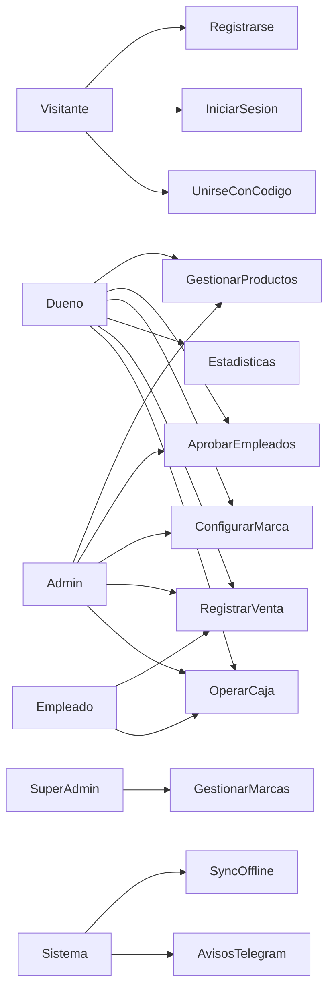
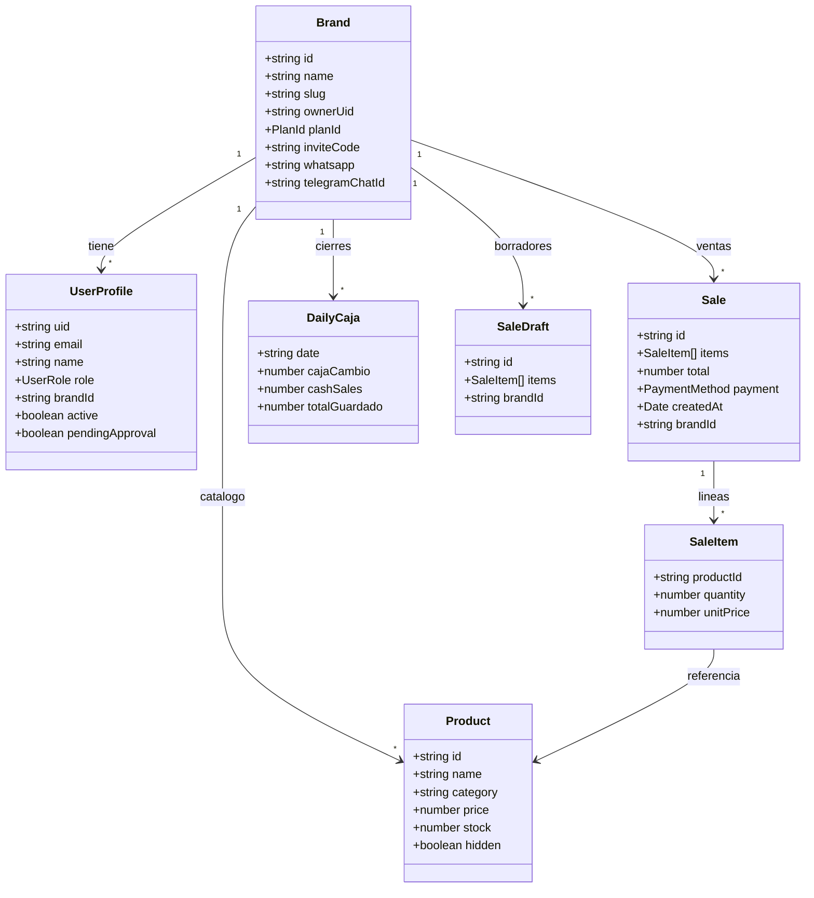
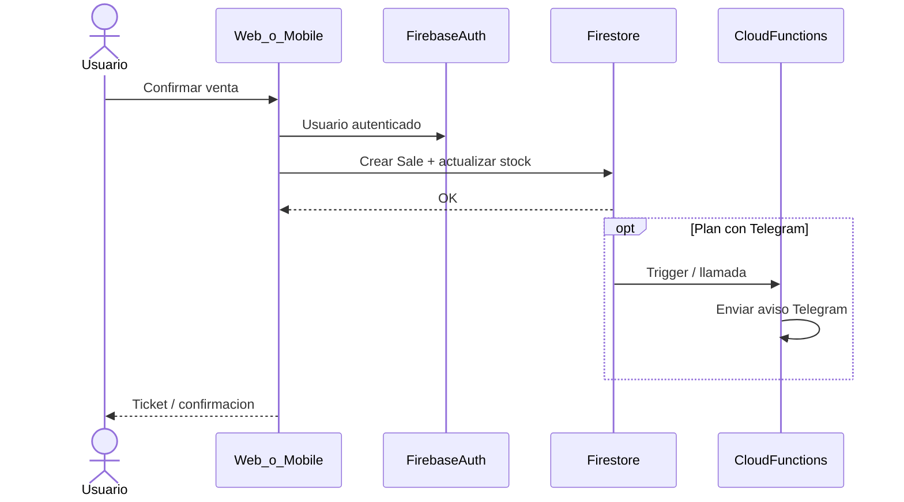
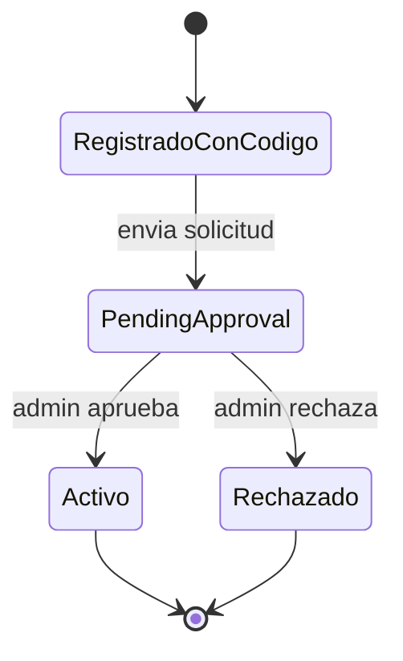

# UML — Control+

**Versión:** 1.0  
**Autor:** Felipe Quesada  

Los diagramas están en Mermaid. Exportá a PNG en https://mermaid.live para pegarlos en Google Docs.

---

## 1. Diagrama de casos de uso (resumen)

---

## 2. Diagrama de clases / dominio (simplificado)

---

## 3. Diagrama de secuencia — Registrar venta

---

## 4. Diagrama de estados — Empleado (join)

