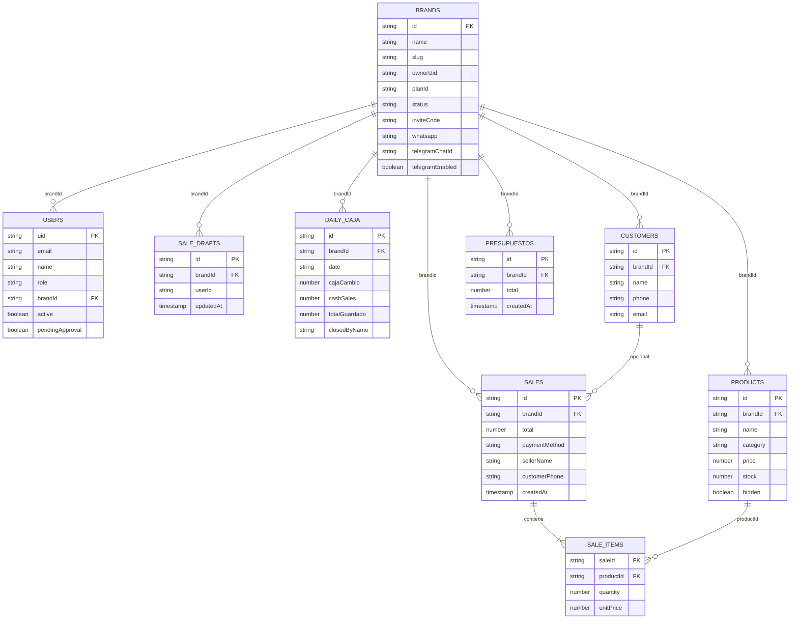

# DER — Modelo de datos (Control+)

**Versión:** 1.0  
**Autor:** Felipe Quesada  
**Nota:** Firestore es NoSQL orientado a documentos. Este DER lógico muestra entidades y relaciones equivalentes para la entrega académica.

---

## 1. Diagrama entidad-relación lógico

---

## 2. Colecciones Firestore (orientativo)

| Colección / path | Contenido |
|------------------|-----------|
| `brands` | Marcas (tenants) |
| `users` | Perfiles (rol, brandId, pending) |
| `brands/{brandId}/products` o colección con `brandId` | Productos |
| ventas / sales | Ventas y líneas |
| saleDrafts | Borradores |
| dailyCaja / caja | Cierres diarios |
| customers | Clientes |
| presupuestos | Presupuestos |
| audit / logs | Auditoría (si aplica) |

> Los paths exactos siguen la implementación en `web/src/services/*` y `mobile/services/*`. El aislamiento se refuerza con **reglas de Firestore** por `brandId` y rol.

---

## 3. Cardinalidades clave

- Una **marca** tiene muchos **usuarios**, **productos** y **ventas**.  
- Una **venta** tiene una o muchas **líneas**; cada línea referencia un producto.  
- Un **día** tiene un registro de **caja** por marca.  
- Un usuario empleado pertenece a **una** marca; el super admin puede no tener `brandId`.
