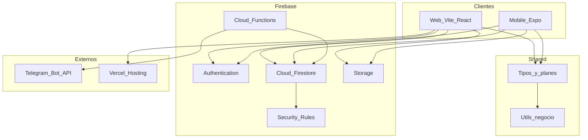

# Diseño de arquitectura — Control+

**Versión:** 1.0  
**Autor:** Felipe Quesada  

---

## 1. Descripción general

Control+ usa una arquitectura **cliente–servidor BaaS**:

- **Clientes:** Web (React/Vite) y Mobile (Expo/React Native).  
- **Backend gestionado:** Firebase (Auth, Firestore, Storage, Cloud Functions).  
- **Código compartido:** paquete `shared/` (tipos, planes, utilidades de negocio).  
- **Deploy:** Web en Vercel; Mobile vía EAS/APK; Functions en Firebase.

No hay servidor propio de aplicación: la lógica sensible (Telegram, config web) vive en **Cloud Functions** y **reglas de seguridad**.

---

## 2. Diagrama de arquitectura

---

## 3. Capas

| Capa | Responsabilidad |
|------|-----------------|
| Presentación | Pantallas web/mobile, landing, presentación |
| Aplicación | Contextos (Auth, Brand, Cart), navegación, formularios |
| Dominio compartido | `shared/`: planes, pagos, cálculos de venta/caja/stock |
| Infraestructura | SDKs Firebase, services por plataforma |
| Seguridad | Auth + Firestore Rules + Secrets |

---

## 4. Multi-tenant

Cada comercio es una **marca** (`brandId`). Usuarios, productos, ventas y caja se filtran por marca. El **super admin** opera a nivel plataforma.

---

## 5. Decisiones relevantes

| Decisión | Motivo |
|----------|--------|
| Firebase | Tiempo real, Auth integrado, bajo ops para TF |
| Monorepo | Misma lógica de negocio en web y mobile |
| Mobile first | Mostrador se opera con el celular |
| Offline solo mobile | Cola local Expo; web asume conectividad |
| Telegram vía Functions | Token nunca en el cliente |
| Planes por `planId` | Monetización y límites claros |

---

## 6. Despliegue

| Componente | Destino |
|------------|---------|
| Web | Vercel (`web/dist`) |
| Mobile | APK Expo/EAS |
| Functions | Firebase project |
| Dominio | controlmas.com.ar |
