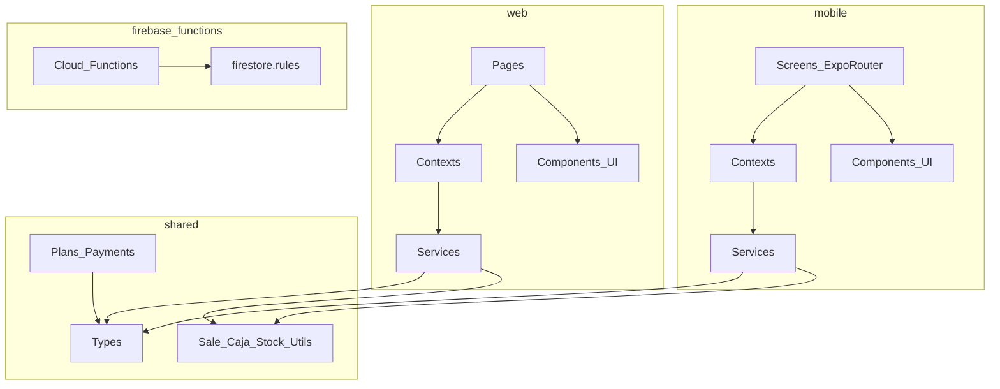
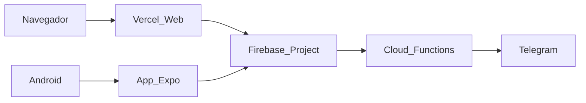

# Diagrama de componentes — Control+

**Versión:** 1.0  
**Autor:** Felipe Quesada  

---

## 1. Vista de componentes del monorepo

---

## 2. Componentes lógicos principales

| Componente | Ubicación | Función |
|------------|-----------|---------|
| Landing / Presentación | `web/src/pages/LandingPage.tsx`, `PresentationPage.tsx` | Marketing y tesis |
| AuthGate / BrandContext | `web` / `mobile` context | Sesión y marca activa |
| Sales / SaleForm | pages + components | Registrar ventas y borradores |
| Products | pages | Catálogo e import |
| Caja | pages | Cierre diario |
| Stock | pages | Inventario |
| Dashboard | pages | KPIs |
| Services Firebase | `*/services/*` | CRUD y queries |
| Shared utils | `shared/src/utils/*` | Reglas de cálculo reutilizables |
| Cloud Functions | `functions/` | Telegram, config web, jobs |
| Security Rules | `firebase/firestore.rules` | Autorización |

---

## 3. Interfaces entre componentes

| Desde | Hacia | Contrato |
|-------|-------|----------|
| UI | Services | Funciones async tipadas |
| Services | Firestore | Colecciones + `brandId` |
| Clients | Auth | Firebase Auth SDK |
| Functions | Telegram | Bot API + secrets |
| Web/Mobile | Shared | Imports npm workspace / path |

---

## 4. Diagrama de despliegue (simplificado)

