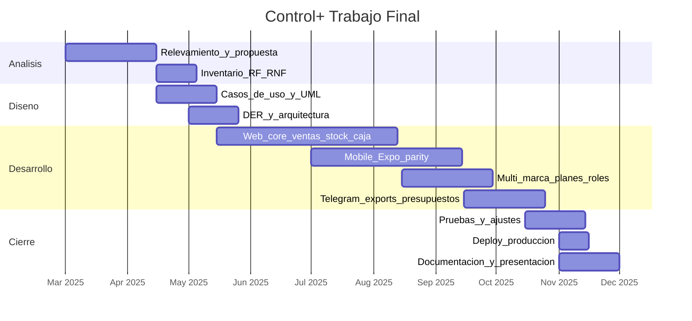

# Cronograma / Gantt — Control+ (Trabajo Final)

**Versión:** 1.0  
**Autor:** Felipe Quesada  

Fechas orientativas del ciclo del TF. Ajustá el calendario real de la cursada al pegar en Docs.

---

## 1. Tabla de fases

| ID | Fase | Actividades | Entregables |
|----|------|-------------|-------------|
| F1 | Análisis | Relevamiento problema, alcance, RF/RNF | Propuesta, inventario requisitos |
| F2 | Diseño | Casos de uso, DER, arquitectura, UI | UML, DER, arquitectura, componentes |
| F3 | Desarrollo Web | Auth, productos, ventas, caja, stock, landing | App web usable |
| F4 | Desarrollo Mobile | Paridad mobile, offline, tabs | APK |
| F5 | Multi-marca / planes | Tenants, roles, join, límites | Marcas y planes |
| F6 | Integraciones | Telegram, exports, presupuestos | Features Pro+ |
| F7 | Pruebas | Casos de prueba, correcciones | Plan de pruebas ejecutado |
| F8 | Deploy | Vercel, Firebase, dominio | Producción controlmas.com.ar |
| F9 | Documentación | Manual, entrega final, presentación | Docs + `/presentacion` |

---

## 2. Diagrama Gantt (Mermaid)

---

## 3. Hitos

| Hito | Descripción |
|------|-------------|
| H1 | Propuesta aprobada / alcance cerrado |
| H2 | MVP web: venta + stock + caja |
| H3 | MVP mobile con sync |
| H4 | Multi-marca y planes en producción |
| H5 | Marcas reales operando (validación) |
| H6 | Entrega documental + presentación |

---

## 4. Dependencias principales

- F3 depende de F1–F2.  
- F4 reutiliza dominio de F3 (`shared/`).  
- F5–F6 amplían F3/F4.  
- F7–F9 cierran el TF.
